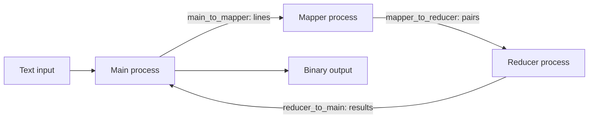
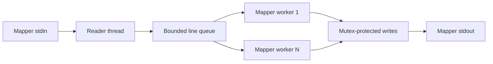
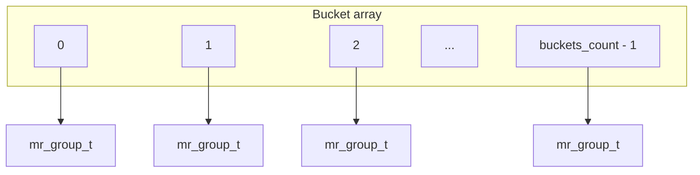
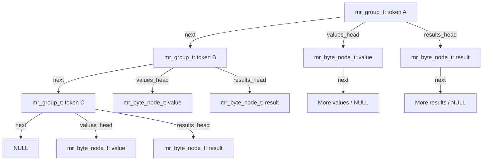

# c11-mapreduce

A local MapReduce framework in C using processes, pipes, and C11 threads.

The project builds **libmr.a**, a static library used through [`include/mr.h`](include/mr.h). Applications supply mapper and reducer callbacks; the framework reads input files, manages processes and threads, groups intermediate values by token, and writes binary results.

Developed by **Gabriele Grazzini**, academic year 2025–2026. This README presents the project report in English, including adaptations of its diagrams. The [original Italian report](relazione.pdf) is included.

## Build and run

Requirements: Linux (target environment: Ubuntu 24.04), GCC, Make, C11 thread support (`threads.h`), and POSIX named semaphores.

Run from the repository root:

```sh
make          # Build libmr.a and both examples
make test     # Execute both example applications
make wc       # Run word_count
make wl       # Run word_length
make clean    # Remove build products, generated output, and mr.log
```

The Makefile uses `-std=gnu11 -Wall -pthread`. To link your own application:

```sh
gcc -std=gnu11 -Wall -pthread -Iinclude app.c -L. -lmr -o app
```

## General architecture

Three processes perform the computation:

- **Main:** reads text input and writes binary output.
- **Mapper:** receives input lines and invokes mapper worker callbacks.
- **Reducer:** groups intermediate pairs by token, invokes reducer workers, and returns results.



Interprocess data exchange uses pipes. Closing a pipe signals the end of data; no special end-of-stream message is sent.

## Public interface

`mr_t` is an opaque computation handle. `mr_attr_t` configures the framework:

| Field | Meaning | Default |
| --- | --- | --- |
| `mapper_threads` | Mapper worker count | 4 |
| `reducer_threads` | Reducer worker count | 4 |
| `queue_size` | Internal queue capacity, not pipe capacity | 64 |
| `log_file` | Log path | `mr.log` |

Configuration setters are `mr_attr_set_mapper_threads()`, `mr_attr_set_reducer_threads()`, `mr_attr_set_queue_size()`, and `mr_attr_set_log_file()`.

The main lifecycle functions are:

```c
int mr_attr_init(mr_attr_t *attr);
int mr_attr_destroy(mr_attr_t *attr);
int mr_create(mr_t *mr, const mr_attr_t *attr,
              mr_mapper_t mapper, mr_reducer_t reducer, void *user_arg);
int mr_start(mr_t mr, const char *input_path, const char *output_path);
int mr_destroy(mr_t mr);
```

The mapper receives an `mr_file_line_t`: a file name, line number, line bytes, and explicit lengths. `file_name` and `line` need not be null-terminated; their pointers are valid only during the callback.

The mapper emits zero or more pairs through `mr_emit_pair_t`. A token must be a null-terminated C string containing only ASCII alphanumeric characters. Intermediate values are opaque bytes.

The reducer receives a token and its associated `mr_value_t` array, then emits zero or more results through `mr_emit_result_t`. The emitted token must match the received token. Result contents are opaque bytes. For values and results, zero size allows a null data pointer.

See the [public header](include/mr.h) for all callback signatures and [word_count](examples/word_count/wc.c) for a complete application.

## Process creation and file descriptors

`mr_start()` creates three pipes and calls `fork()` twice. In each child, `dup2()` connects the appropriate pipe endpoints to standard input and output:

| Child | Standard input | Standard output |
| --- | --- | --- |
| Mapper | `main_to_mapper[0]` | `mapper_to_reducer[1]` |
| Reducer | `mapper_to_reducer[0]` | `reducer_to_main[1]` |

Unused descriptors are closed after duplication, allowing readers to receive EOF correctly. The main process sends serialized lines, closes the input pipe, reads final results, writes the output file, and waits for both children with `waitpid()`.

## C11 threads

The mapper has one reader thread and a configurable number of workers. The reader receives lines from standard input and places them in a bounded queue. Workers dequeue lines and invoke the application mapper. A mutex protects pipe writes so complete messages do not interleave.



The reducer has no separate reader thread: it reads and groups all pairs before starting reducer workers. Its main thread then enqueues complete groups and closes the queue. Workers run the reducer callback and store results in the corresponding groups. Once all workers finish, results are written in lexicographic token order.

## Internal queues and synchronization

Queues are fixed-capacity circular buffers containing a `void **buf` array, `head` and `tail` indices, an element count, a `closed` flag, a C11 `mtx_t` mutex, and two C11 condition variables: `not_full` and `not_empty`.

A producer waits on `not_full` when the queue is full. A consumer waits on `not_empty` when it is empty. Closing the queue wakes all waiting threads.

## Error-checking macros

[`src/macros.h`](src/macros.h) provides common checks that log an error and jump to a cleanup label using `goto fail`:

| Macro | Behavior |
| --- | --- |
| `CHECK_MINUS_ONE(call, message)` | Detect a system call returning `-1`. |
| `CHECK_NULL(ptr, message)` | Detect a null pointer. |
| `CHECK_READ_FULL_OR_EOF(call, expected, message)` | Jump to `eof` on zero bytes; otherwise require the expected byte count. |
| `CHECK_READ_WRITE_FULL(call, expected, message)` | Require the exact expected transfer size. |
| `CHECK_THRD_SUCCESS(call, message)` | Require `thrd_success` from a C11 thread operation. |

Macros do not release resources. Each function supplies the necessary `fail` and, where applicable, `eof` labels and performs its own cleanup.

## Pipe message formats

All messages use explicit lengths. Helpers equivalent to `readn()` and `writen()` handle partial transfers. Headers are defined in [`src/mr_internal.h`](src/mr_internal.h).

### Main to mapper

```c
typedef struct {
    int file_name_len;
    unsigned long line_number;
    int line_len;
} mr_line_header_t;
```

```text
mr_line_header_t header
file_name_len bytes of file_name
line_len bytes of line
```

`file_name_len` must be positive; `line_len` may be zero. The newline character is not transmitted.

### Mapper to reducer

```c
typedef struct {
    int token_len;
    int value_len;
} mr_pair_header_t;
```

```text
mr_pair_header_t header
token_len bytes of token
value_len bytes of opaque value
```

`token_len` excludes the null terminator, which the reducer adds locally. Length limits are `0 < token_len <= 4096` and `0 <= value_len <= 64 * 1024 * 1024`.

### Reducer to main

```c
typedef struct {
    int token_len;
    int result_len;
} mr_result_header_t;
```

```text
mr_result_header_t header
token_len bytes of token
result_len bytes of opaque result
```

`token_len` excludes the null terminator. The main process validates lengths before using them: `0 < token_len <= 4096` and `0 <= result_len <= 64 * 1024 * 1024`.

Headers use native C representations and are intended for local communication between processes of the same application, rather than a portable network protocol.

## Token grouping

The reducer uses a hash table with separate chaining. Each bucket points to the first group in a collision chain; each group represents a distinct token.

```c
typedef struct {
    mr_group_t **buckets;
    size_t buckets_count;
    size_t groups_count;
} mr_group_table_t;
```

The following diagram adapts **Figure 1** of the report, showing the bucket array and pointers to the first groups. Empty buckets contain null pointers.



For each incoming pair, insertion computes the bucket index. If that bucket already contains the token, the value is appended to its values list; otherwise a new group is inserted into the chain.

### Hash function

`hash_token()` starts from zero and processes each token byte with a polynomial hash:

```c
hash = hash * 31 + (unsigned char)token[i];
bucket = hash_token(token, token_len) % table->buckets_count;
```

Multiplication by 31 makes character order affect the result. Tokens with the same characters in different orders generally produce different hashes.

### Groups and byte nodes

Intermediate values and final results are stored in separate linked lists:

```c
typedef struct mr_byte_node {
    void *data;
    size_t len;
    struct mr_byte_node *next;
} mr_byte_node_t;

typedef struct mr_group {
    char *token;
    size_t token_len;
    mr_byte_node_t *values_head;
    mr_byte_node_t *values_tail;
    size_t values_count;
    mr_byte_node_t *results_head;
    mr_byte_node_t *results_tail;
    size_t results_count;
    struct mr_group *next;
} mr_group_t;
```

The next diagram adapts **Figure 2** of the report. Group `next` pointers form the bucket's collision chain. Each group points separately to its values and results lists; byte nodes have their own `next` pointers.



Each intermediate value and each emitted result is copied into a byte node. The framework uses `len` without interpreting the stored bytes.

Hash table traversal is not lexicographically ordered. After grouping, the reducer creates an array of group pointers and sorts it by token with `qsort()`. This determines output token order. Results within a token retain their callback emission order; result contents depend on the application callbacks.

## Binary output

Each record consists of sequentially written fields:

```text
int token_len
token_len bytes of token
int result_len
result_len bytes of result
```

The token excludes its null terminator. Results may contain null bytes and may have zero length. Records are ordered lexicographically by token, with multiple results for a token written in emission order. Integers use native C representation, so this is not a platform-independent interchange format.

## Logging

The default log is `mr.log`; an application can configure another path. Each line has this format:

```text
[elapsed_time] [pid] [thread] [event] message
```

Time is relative to the start of processing. Process and C11 thread IDs identify the event source. Logged events include pipe and process creation, thread startup and termination, file operations, line and pair counts, distinct token counts, final result counts, and errors.

The POSIX named semaphore `/mr_log` synchronizes log writes across processes and threads.

## Examples and tests

`make test` executes two example applications and prints decoded results. These are demonstration runs rather than an assertion-based unit test suite.

### Word count

[`examples/word_count/wc.c`](examples/word_count/wc.c) reads `examples/word_count/input.txt` and writes `examples/word_count/output.mro`.

The mapper scans using `line_len`, extracts alphanumeric tokens, converts them to lowercase, and emits integer `1` for each occurrence. The reducer sums values for each token.

For the illustrative input:

```text
Ciao ciao prova
```

The mapper emits:

```text
<ciao, 1>
<ciao, 1>
<prova, 1>
```

The decoded output is:

```text
ciao 2
prova 1
```

### Word length

[`examples/word_length/wl.c`](examples/word_length/wl.c) reads files from `examples/word_length/input` and writes `examples/word_length/output.mro`.

The mapper extracts alphanumeric tokens, emits a key `lenN` for each token of length `N`, and associates integer `1` with it. The reducer sums values per length.

For the illustrative input:

```text
fork pipe dup2 in C
```

The mapper emits:

```text
<len4, 1>
<len4, 1>
<len4, 1>
<len2, 1>
<len1, 1>
```

The decoded output is:

```text
len1 1
len2 1
len4 3
```

Different words of the same length share a group: `fork`, `pipe`, and `dup2` all contribute to `len4`.

## Repository layout

```text
include/mr.h             Public API
src/                     Implementation and internal headers
examples/word_count/     Word frequency example and input
examples/word_length/    Word length example and input files
Makefile                 Build and execution targets
relazione.pdf            Original project report (Italian)
```
